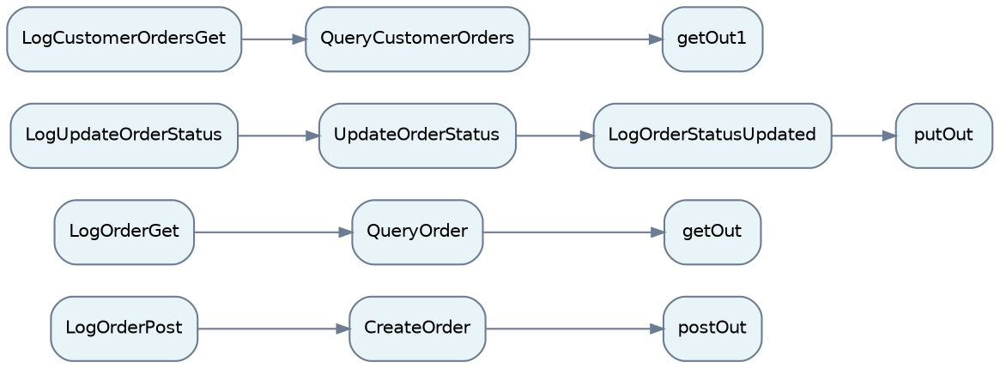
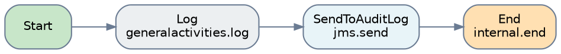
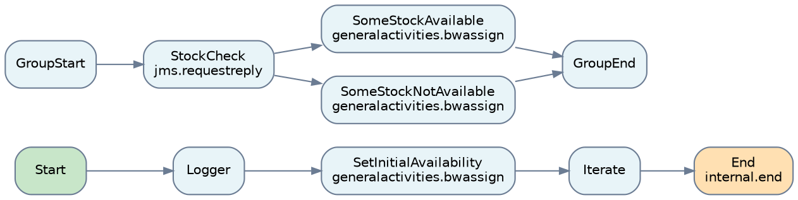
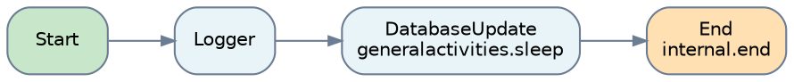
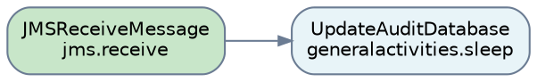

# Processes

11 processes with 23 palette activities (calls to other processes are listed under *Calls*).

## Inventory

| Process | Triggered by | Activities | Calls | Fault handlers |
|---|---|---|---|---|
| UpdateOrderStatus | Sub-process, called by OrdersRESTInterface | 2 | Logger | 0 |
| StockCheck | JMS StockCheck | 3 | Logger | 0 |
| QueryOrder | Sub-process, called by OrdersRESTInterface | 2 | Logger | 0 |
| QueryCustomerOrders | Sub-process, called by OrdersRESTInterface | 2 | Logger | 0 |
| OrdersRESTInterface | REST POST /api/orders, GET /api/orders/{orderId}, PUT /api/orders/{orderId}, GET /api/orders/customer/{customerId} | 0 | CreateOrderProcess, Logger, QueryOrder, UpdateOrderStatus, QueryCustomerOrders | 0 |
| Logger | Sub-process, called by UpdateOrderStatus, StockCheck, QueryOrder, QueryCustomerOrders, OrdersRESTInterface, InventoryCheck, DatabaseUpdate, CreateOrderProcess, Activator | 3 | - | 0 |
| InventoryCheck | Sub-process, called by CreateOrderProcess | 5 | Logger | 0 |
| DatabaseUpdate | Sub-process, called by CreateOrderProcess | 2 | Logger | 0 |
| CreateOrderProcess | Sub-process, called by OrdersRESTInterface | 2 | Logger, DatabaseUpdate, InventoryCheck | 0 |
| AuditLog | JMS LogMessage | 2 | - | 0 |
| Activator | Module start/stop | 0 | Logger | 0 |

## Call tree

Each entry point (REST operation, JMS receiver, timer, module activator) and the processes it calls, in call order.

- **StockCheck** (JMS StockCheck)
    - **Logger**
- **OrdersRESTInterface** (REST POST /api/orders, GET /api/orders/{orderId}, PUT /api/orders/{orderId}, GET /api/orders/customer/{customerId})
    - **CreateOrderProcess**
        - **Logger**
        - **DatabaseUpdate**
            - **Logger**
        - **InventoryCheck**
            - **Logger**
    - **Logger**
    - **QueryOrder**
        - **Logger**
    - **UpdateOrderStatus**
        - **Logger**
    - **QueryCustomerOrders**
        - **Logger**
- **AuditLog** (JMS LogMessage)
- **Activator** (Module start/stop)
    - **Logger**

## Process details

### UpdateOrderStatus

- File: `OrderProcessing.module/Processes/orderprocessing/module/UpdateOrderStatus.bwp`
- Triggered by: Sub-process, called by OrdersRESTInterface
- Called by: OrdersRESTInterface
- Activities:
    - `bw.internal.end` x 1
    - `bw.generalactivities.sleep` x 1
- Flow: see below.

#### Flow of UpdateOrderStatus

```graphviz dot updateorderstatus-flow.svg
digraph "UpdateOrderStatus" {
  rankdir=LR; bgcolor="transparent";
  node [shape=box, style="rounded,filled", fontname="Helvetica", fontsize=10, fillcolor="#e8f4f8", color="#6b7c93"];
  edge [color="#6b7c93", arrowsize=0.7];

  "Start" [label="Start", fillcolor="#c8e6c9"];

  "LoggerUpdateStatus" [label="LoggerUpdateStatus", fillcolor="#e8f4f8"];

  "GetSharedVariable" [label="GetSharedVariable", fillcolor="#e8f4f8"];

  "UpdateOrderDatabase" [label="UpdateOrderDatabase\ngeneralactivities.sleep", fillcolor="#e8f4f8"];

  "End" [label="End\ninternal.end", fillcolor="#ffe0b2"];
"Start" -> "LoggerUpdateStatus";
"LoggerUpdateStatus" -> "GetSharedVariable";
"GetSharedVariable" -> "UpdateOrderDatabase";
"UpdateOrderDatabase" -> "End";
}
```

| From | To |
|---|---|
| Start | LoggerUpdateStatus |
| LoggerUpdateStatus | GetSharedVariable |
| GetSharedVariable | UpdateOrderDatabase |
| UpdateOrderDatabase | End |

### StockCheck

- File: `OrderProcessing.module/Processes/orderprocessing/module/StockCheck.bwp`
- Triggered by: JMS StockCheck
- Activities:
    - `bw.jms.receive` x 1
    - `bw.jms.reply` x 1
    - `bw.generalactivities.confirm` x 1
- Flow: see below.
- Activities that talk to other systems:
    - **JMSReceiveMessage** (`bw.jms.receive`): destination StockCheck, connection `jmsConnection`
    - **ReplytoJMSMessage** (`bw.jms.reply`)

#### Flow of StockCheck

```graphviz dot stockcheck-flow.svg
digraph "StockCheck" {
  rankdir=LR; bgcolor="transparent";
  node [shape=box, style="rounded,filled", fontname="Helvetica", fontsize=10, fillcolor="#e8f4f8", color="#6b7c93"];
  edge [color="#6b7c93", arrowsize=0.7];

  "JMSReceiveMessage" [label="JMSReceiveMessage\njms.receive", fillcolor="#c8e6c9"];

  "LogCheckingStock" [label="LogCheckingStock", fillcolor="#e8f4f8"];

  "ReplytoJMSMessage" [label="ReplytoJMSMessage\njms.reply", fillcolor="#ffe0b2"];

  "Confirm" [label="Confirm\ngeneralactivities.confirm", fillcolor="#e8f4f8"];

  "LogStockLevels" [label="LogStockLevels", fillcolor="#e8f4f8"];
"JMSReceiveMessage" -> "LogCheckingStock";
"ReplytoJMSMessage" -> "Confirm";
"Confirm" -> "LogStockLevels";
"LogCheckingStock" -> "ReplytoJMSMessage";
}
```

| From | To |
|---|---|
| JMSReceiveMessage | LogCheckingStock |
| ReplytoJMSMessage | Confirm |
| Confirm | LogStockLevels |
| LogCheckingStock | ReplytoJMSMessage |

### QueryOrder

- File: `OrderProcessing.module/Processes/orderprocessing/module/QueryOrder.bwp`
- Triggered by: Sub-process, called by OrdersRESTInterface
- Called by: OrdersRESTInterface
- Activities:
    - `bw.internal.end` x 1
    - `bw.generalactivities.sleep` x 1
- Flow: see below.

#### Flow of QueryOrder

```graphviz dot queryorder-flow.svg
digraph "QueryOrder" {
  rankdir=LR; bgcolor="transparent";
  node [shape=box, style="rounded,filled", fontname="Helvetica", fontsize=10, fillcolor="#e8f4f8", color="#6b7c93"];
  edge [color="#6b7c93", arrowsize=0.7];

  "Start" [label="Start", fillcolor="#c8e6c9"];

  "Logger" [label="Logger", fillcolor="#e8f4f8"];

  "OrderDatabaseQuery" [label="OrderDatabaseQuery\ngeneralactivities.sleep", fillcolor="#e8f4f8"];

  "GetOrderStatus" [label="GetOrderStatus", fillcolor="#e8f4f8"];

  "GetCustomer" [label="GetCustomer", fillcolor="#e8f4f8"];

  "GetProduct" [label="GetProduct", fillcolor="#e8f4f8"];

  "End" [label="End\ninternal.end", fillcolor="#ffe0b2"];
"Start" -> "Logger";
"Logger" -> "OrderDatabaseQuery";
"OrderDatabaseQuery" -> "GetOrderStatus";
"GetOrderStatus" -> "GetCustomer";
"GetCustomer" -> "GetProduct";
"GetProduct" -> "End";
}
```

| From | To |
|---|---|
| Start | Logger |
| Logger | OrderDatabaseQuery |
| OrderDatabaseQuery | GetOrderStatus |
| GetOrderStatus | GetCustomer |
| GetCustomer | GetProduct |
| GetProduct | End |

### QueryCustomerOrders

- File: `OrderProcessing.module/Processes/orderprocessing/module/QueryCustomerOrders.bwp`
- Triggered by: Sub-process, called by OrdersRESTInterface
- Called by: OrdersRESTInterface
- Activities:
    - `bw.internal.end` x 1
    - `bw.generalactivities.sleep` x 1
- Flow: see below.

#### Flow of QueryCustomerOrders

```graphviz dot querycustomerorders-flow.svg
digraph "QueryCustomerOrders" {
  rankdir=LR; bgcolor="transparent";
  node [shape=box, style="rounded,filled", fontname="Helvetica", fontsize=10, fillcolor="#e8f4f8", color="#6b7c93"];
  edge [color="#6b7c93", arrowsize=0.7];

  "Start" [label="Start", fillcolor="#c8e6c9"];

  "Logger" [label="Logger", fillcolor="#e8f4f8"];

  "QueryOrdersDatabase" [label="QueryOrdersDatabase\ngeneralactivities.sleep", fillcolor="#e8f4f8"];

  "GetCustomer" [label="GetCustomer", fillcolor="#e8f4f8"];

  "GetProduct" [label="GetProduct", fillcolor="#e8f4f8"];

  "GetOrderStatus" [label="GetOrderStatus", fillcolor="#e8f4f8"];

  "End" [label="End\ninternal.end", fillcolor="#ffe0b2"];
"Start" -> "Logger";
"Logger" -> "QueryOrdersDatabase";
"QueryOrdersDatabase" -> "GetCustomer";
"GetCustomer" -> "GetProduct";
"GetProduct" -> "GetOrderStatus";
"GetOrderStatus" -> "End";
}
```

| From | To |
|---|---|
| Start | Logger |
| Logger | QueryOrdersDatabase |
| QueryOrdersDatabase | GetCustomer |
| GetCustomer | GetProduct |
| GetProduct | GetOrderStatus |
| GetOrderStatus | End |

### OrdersRESTInterface

- File: `OrderProcessing.module/Processes/orderprocessing/module/OrdersRESTInterface.bwp`
- Triggered by: REST POST /api/orders, GET /api/orders/{orderId}, PUT /api/orders/{orderId}, GET /api/orders/customer/{customerId}
- Flow: see below.

#### Flow of OrdersRESTInterface

| From | To |
|---|---|
| CreateOrder | postOut |
| LogOrderPost | CreateOrder |
| LogOrderGet | QueryOrder |
| QueryOrder | getOut |
| LogUpdateOrderStatus | UpdateOrderStatus |
| UpdateOrderStatus | LogOrderStatusUpdated |
| LogOrderStatusUpdated | putOut |
| LogCustomerOrdersGet | QueryCustomerOrders |
| QueryCustomerOrders | getOut1 |

### Logger

- File: `OrderProcessing.module/Processes/orderprocessing/module/Logger.bwp`
- Triggered by: Sub-process, called by UpdateOrderStatus, StockCheck, QueryOrder, QueryCustomerOrders, OrdersRESTInterface, InventoryCheck, DatabaseUpdate, CreateOrderProcess, Activator
- Called by: UpdateOrderStatus, StockCheck, QueryOrder, QueryCustomerOrders, OrdersRESTInterface, InventoryCheck, DatabaseUpdate, CreateOrderProcess, Activator
- Activities:
    - `bw.internal.end` x 1
    - `bw.generalactivities.log` x 1
    - `bw.jms.send` x 1
- Flow: see below.
- Activities that talk to other systems:
    - **SendToAuditLog** (`bw.jms.send`): destination LogMessage, connection `jmsConnection`

#### Flow of Logger

| From | To |
|---|---|
| Start | Log |
| Log | SendToAuditLog |
| SendToAuditLog | End |

### InventoryCheck

- File: `OrderProcessing.module/Processes/orderprocessing/module/InventoryCheck.bwp`
- Triggered by: Sub-process, called by CreateOrderProcess
- Called by: CreateOrderProcess
- Activities:
    - `bw.internal.end` x 1
    - `bw.jms.requestreply` x 1
    - `bw.generalactivities.bwassign` x 3
- Flow: see below.
- Activities that talk to other systems:
    - **StockCheck** (`bw.jms.requestreply`): destination StockCheck, connection `jmsConnection`

#### Flow of InventoryCheck

| From | To |
|---|---|
| Start | Logger |
| Logger | SetInitialAvailability |
| Iterate | End |
| GroupStart | StockCheck |
| StockCheck | SomeStockAvailable |
| StockCheck | SomeStockNotAvailable |
| SomeStockAvailable | GroupEnd |
| SomeStockNotAvailable | GroupEnd |
| SetInitialAvailability | Iterate |

### DatabaseUpdate

- File: `OrderProcessing.module/Processes/orderprocessing/module/DatabaseUpdate.bwp`
- Triggered by: Sub-process, called by CreateOrderProcess
- Called by: CreateOrderProcess
- Activities:
    - `bw.internal.end` x 1
    - `bw.generalactivities.sleep` x 1
- Flow: see below.

#### Flow of DatabaseUpdate

| From | To |
|---|---|
| Start | Logger |
| Logger | DatabaseUpdate |
| DatabaseUpdate | End |

### CreateOrderProcess

- File: `OrderProcessing.module/Processes/orderprocessing/module/CreateOrderProcess.bwp`
- Triggered by: Sub-process, called by OrdersRESTInterface
- Called by: OrdersRESTInterface
- Activities:
    - `bw.internal.end` x 1
    - `bw.jms.send` x 1
- Flow: see below.
- Activities that talk to other systems:
    - **SendOrderDetails** (`bw.jms.send`): destination Orders, connection `jmsConnection`

#### Flow of CreateOrderProcess

```graphviz dot createorderprocess-flow.svg
digraph "CreateOrderProcess" {
  rankdir=LR; bgcolor="transparent";
  node [shape=box, style="rounded,filled", fontname="Helvetica", fontsize=10, fillcolor="#e8f4f8", color="#6b7c93"];
  edge [color="#6b7c93", arrowsize=0.7];

  "Start" [label="Start", fillcolor="#c8e6c9"];

  "Logger" [label="Logger", fillcolor="#e8f4f8"];

  "InsertOrderIntoDB" [label="InsertOrderIntoDB", fillcolor="#e8f4f8"];

  "InventoryCheck" [label="InventoryCheck", fillcolor="#e8f4f8"];

  "SendOrderDetails" [label="SendOrderDetails\njms.send", fillcolor="#e8f4f8"];

  "NoStockAvailable" [label="NoStockAvailable", fillcolor="#e8f4f8"];

  "OrderCreatedLog" [label="OrderCreatedLog", fillcolor="#e8f4f8"];

  "Empty" [label="Empty", fillcolor="#e8f4f8"];

  "End" [label="End\ninternal.end", fillcolor="#ffe0b2"];
"Start" -> "Logger";
"Logger" -> "InsertOrderIntoDB";
"InsertOrderIntoDB" -> "InventoryCheck";
"InventoryCheck" -> "SendOrderDetails";
"InventoryCheck" -> "NoStockAvailable";
"SendOrderDetails" -> "OrderCreatedLog";
"OrderCreatedLog" -> "Empty";
"NoStockAvailable" -> "Empty";
"Empty" -> "End";
}
```

| From | To |
|---|---|
| Start | Logger |
| Logger | InsertOrderIntoDB |
| InsertOrderIntoDB | InventoryCheck |
| InventoryCheck | SendOrderDetails |
| InventoryCheck | NoStockAvailable |
| SendOrderDetails | OrderCreatedLog |
| OrderCreatedLog | Empty |
| NoStockAvailable | Empty |
| Empty | End |

### AuditLog

- File: `OrderProcessing.module/Processes/orderprocessing/module/AuditLog.bwp`
- Triggered by: JMS LogMessage
- Activities:
    - `bw.jms.receive` x 1
    - `bw.generalactivities.sleep` x 1
- Flow: see below.
- Activities that talk to other systems:
    - **JMSReceiveMessage** (`bw.jms.receive`): destination LogMessage, connection `jmsConnection`

#### Flow of AuditLog

| From | To |
|---|---|
| JMSReceiveMessage | UpdateAuditDatabase |

### Activator

- File: `OrderProcessing.module/Processes/orderprocessing/module/Activator.bwp`
- Triggered by: Module start/stop
- Flow: see below.

#### Flow of Activator

| From | To |
|---|---|
| StartupLogger | SetupOrderStatusVariable |
| SetupOrderStatusVariable | SetupCustomersVariable |
| SetupCustomersVariable | SetupProductsVariable |

