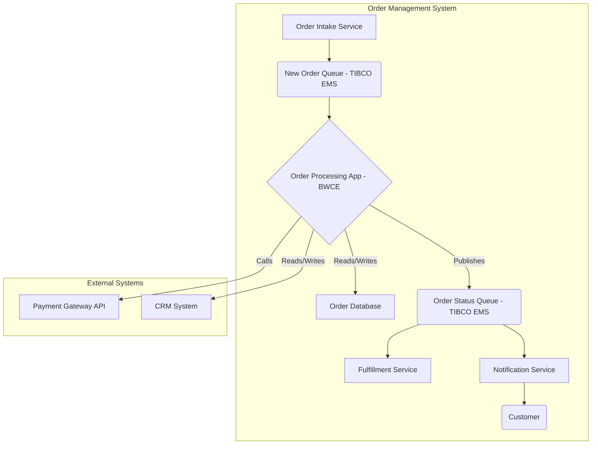
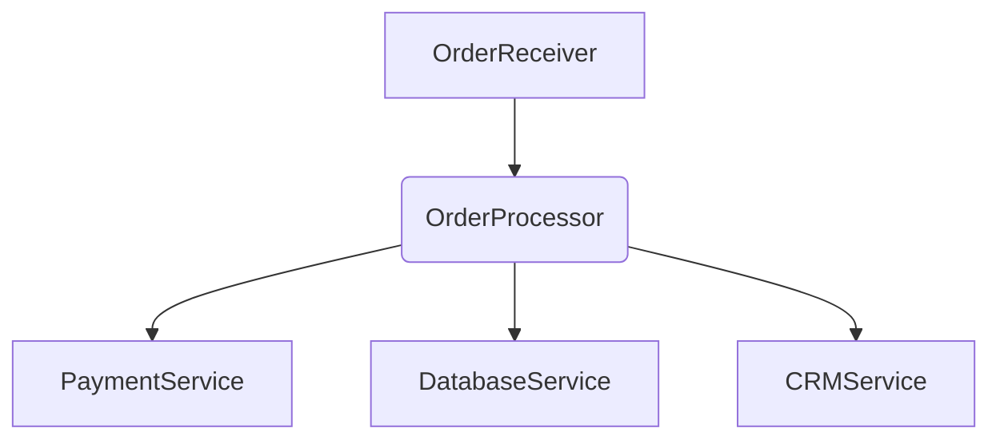

# Application Architecture

This document provides an overview of the architecture of the Order Processing Application, highlighting its key components, integration points, and data flows.

---

## 1. High-Level Overview

The Order Processing Application is a core component within the larger Order Management System. It acts as an integration layer, receiving new order requests, orchestrating data enrichment and persistence, and dispatching notifications based on order status.


---

### Part 2: Component Breakdown

Now, here's the second section, detailing the component breakdown within the BusinessWorks application and its corresponding Mermaid diagram:

```markdown
* **Order Intake Service:** A frontend or upstream service that initiates new order requests.
* **New Order Queue (TIBCO EMS):** The primary input channel for the Order Processing Application, ensuring reliable message delivery.
* **Order Processing App (BWCE):** The central BusinessWorks application responsible for the core logic.
* **Order Database:** Persists all order-related transactional data.
* **Order Status Queue (TIBCO EMS):** Publishes updates on order lifecycle stages.
* **Fulfillment Service:** Consumes order status updates to initiate physical fulfillment.
* **Notification Service:** Consumes order status updates to send customer communications.
* **Payment Gateway API:** An external service called for payment processing.
* **CRM System:** Used for customer data lookups (reads) and possibly updates (writes).
```
---

## 2. Component Breakdown (Order Processing App - BWCE)

The BusinessWorks application is logically divided into several process modules:

* **`OrderReceiver`:**
    * **Purpose:** Listens on `queue.order.new` for incoming `OrderRequest` messages.
    * **Flow:** Receives message -> Basic validation -> Triggers `OrderProcessor` asynchronously.
* **`OrderProcessor`:**
    * **Purpose:** Orchestrates the main order processing flow.
    * **Flow:**
        1.  Calls `PaymentService` to authorize payment.
        2.  Interacts with `DatabaseService` to save order details.
        3.  Updates order status.
        4.  Publishes order status to `queue.order.status`.
        5.  Calls `CRMService` for customer data updates.
* **`PaymentService`:**
    * **Purpose:** Encapsulates calls to the external Payment Gateway API.
    * **Protocol:** REST/HTTP.
* **`DatabaseService`:**
    * **Purpose:** Handles all interactions with the Order Database.
    * **Operations:** Insert order, update order status, query order details.
    * **Technology:** JDBC (simulated with randomized sleep activities in dev).
* **`CRMService`:**
    * **Purpose:** Manages interactions with the CRM system for customer data.
    * **Protocol:** SOAP/REST (depending on CRM API).



---

## 3. Data Flow

1.  **New Order Request:** JSON message from `Order Intake Service` -> `queue.order.new`.
2.  **Order Processing:** BWCE consumes message, extracts data.
3.  **Payment Authorization:** `OrderProcessor` calls `PaymentService` which translates and calls `Payment Gateway API` (JSON/XML).
4.  **Data Persistence:** `OrderProcessor` calls `DatabaseService` to insert/update records in `Order Database`.
5.  **Status Update:** `OrderProcessor` publishes `OrderStatus` JSON message -> `queue.order.status`.
6.  **CRM Update:** `OrderProcessor` calls `CRMService` to update customer profile (if needed).

---

## 4. Key Technologies

* **TIBCO BusinessWorks Container Edition (BWCE):** Core integration platform.
* **TIBCO Enterprise Message Service (EMS):** Messaging backbone for internal communication.
* **PostgreSQL (Simulated):** Relational database for transactional order data.
* **GitHub:** Source code management.
* **Backstage.io (Developer Hub):** Developer portal for component cataloging and documentation.

---

<h2>5. Deployment Considerations</h2>

The application is deployed as a Docker container within our Kubernetes cluster. Configuration is managed via environment variables and Kubernetes secrets.

Further details on deployment and operations can be found in the [Troubleshooting Guide](troubleshooting.md).
